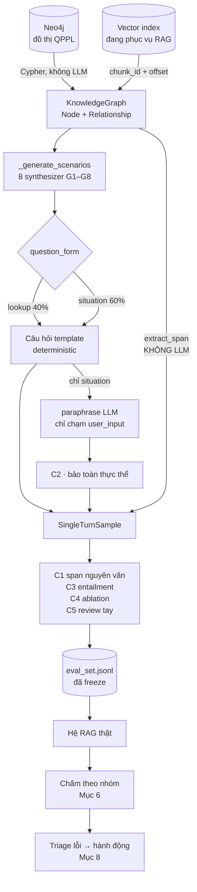

# Sinh bộ câu hỏi eval cho RAG pháp luật từ đồ thị văn bản QPPL

**Trạng thái:** bản chốt · **Nháp cũ:** `archive/v1–v3`

---

## 0 — Tóm tắt

Xây bộ eval 400 câu cho hệ RAG của `legal-rag`, mượn bộ khung kiến trúc testset generation của Ragas nhưng thay hai tầng đầu bằng đồ thị pháp lý thật trong Neo4j.

Ràng buộc chi phối toàn bộ thiết kế:

> **Mọi câu hỏi và đáp án phải truy được nguyên văn về văn bản quy phạm pháp luật gốc. Không một chữ nào trong đáp án được do LLM tự viết ra rồi coi là sự thật.**

Ràng buộc này không phải lời hứa — nó được cụ thể hoá thành 4 bất biến kiểm được bằng máy (Mục 2) và 5 cổng kiểm tự động thi hành chúng. Ragas không cho ta điều đó sẵn: `_generate_sample()` mặc định để LLM viết **cả** câu hỏi **lẫn** `reference` answer. Toàn bộ giá trị của tài liệu này nằm ở chỗ chẻ đôi bước đó ra.

---

## 1 — Toàn cảnh pipeline



Đường của `reference` (bên phải) **không đi qua LLM ở bất kỳ đâu**. Đường của `user_input` có LLM, nhưng bị chặn ngay bởi cổng C2. Hai đường không giao nhau — đó là toàn bộ cơ chế bảo đảm grounding.

---

## 1.5 — Đầu vào, đầu ra, và một ví dụ xuyên suốt

Mục này giải thích hệ thống bằng ngôn ngữ thường, dành cho người đọc lần đầu. Các mục sau đi vào chi tiết kỹ thuật.

### Hệ thống làm hai việc tách rời

| | Làm gì | Chạy khi nào |
|---|---|---|
| **Giai đoạn 1 — Ra đề** | Đọc đồ thị luật, tự động soạn 400 câu hỏi **kèm đáp án và ba-rem chấm** | Một lần, rồi đóng băng |
| **Giai đoạn 2 — Chấm thi** | Đưa 400 câu đó cho hệ RAG trả lời, so với đáp án, chỉ ra sai ở đâu | Mỗi lần đổi tham số retrieval |

Ví von: giai đoạn 1 là **ra đề thi**, trong đó đáp án được **chép nguyên văn từ sách gốc** chứ không phải người ra đề tự nghĩ. Giai đoạn 2 là **chấm bài** — thí sinh chính là hệ RAG. Tách đôi vì đề chỉ soạn một lần nhưng chấm thì chạy đi chạy lại hàng chục lần.

### Đầu vào

| # | Nguồn | Lấy gì ra |
|---|---|---|
| 1 | **Neo4j** — đồ thị văn bản QPPL | Số hiệu, số Điều/Khoản, mốc hiệu lực, nội dung nguyên văn, quan hệ `REPLACES` / `AMENDS` / `GUIDED_BY` |
| 2 | **Vector index đang phục vụ RAG** | `chunk_id` + text từng chunk — để biết "đáp án nằm ở chunk nào mà retriever *có thể* trả về" |
| 3 | **Hệ RAG thật** *(chỉ giai đoạn 2)* | Câu trả lời + các chunk nó thực sự lấy được |

Nguồn 2 hay bị bỏ quên nhưng bắt buộc: không có nó thì biết đáp án đúng nhưng **không biết retriever lẽ ra phải tìm được cái gì** ⇒ không chấm được phần truy hồi.

### Đầu ra

| Đầu ra | Nội dung | Dùng để |
|---|---|---|
| **`eval_set.jsonl`** — 400 dòng, đóng băng | Câu hỏi, đáp án, chunk chứa đáp án, cách chấm | Bộ đề dùng lại mãi |
| **`report.json`** — mỗi lần chạy | Điểm tách theo 8 nhóm, và **sai vì lý do gì** | Quyết định sửa cái gì tiếp |

### Ví dụ xuyên suốt

*(số liệu minh hoạ)*

**B1 · Cypher rút ra một ca.** Tìm Expression có khoảng hiệu lực **đã đóng**, cùng văn bản thay thế nó:

```
Điều 6 — Nghị định 15/2018/NĐ-CP   hiệu lực 02/02/2018 → 30/06/2021   [chunk c_71902]
      │
      │  (:Norm)-[:REPLACES]->(:Norm)
      ↓
Điều 8 — Nghị định 99/2021/NĐ-CP   hiệu lực 01/07/2021 → nay          [chunk c_88213]
```

→ Ca có mốc chuyển giao rõ ràng, dùng được cho nhóm **G2′** (§4.4).

**B2 · Chọn mốc thời gian.** Lấy `05/07/2021` — **sát ngay sau mốc chuyển giao 5 ngày** (`as_of_kind = near_boundary`, §4.1). Chỉ ca sát biên mới phân biệt được hệ có thật sự lọc theo thời gian hay chỉ trả về văn bản mới nhất.
→ Đáp án đúng = **Nghị định 99/2021**; Nghị định 15/2018 trở thành **bẫy** (`distractor`).

**B3 · Lấy đáp án — không có LLM.** Cắt nguyên văn từ `c_88213`, ký tự 412–690:
> *"Tổ chức, cá nhân sản xuất, kinh doanh thực phẩm phải đăng ký bản công bố…"*

→ `reference` = đúng chuỗi đó + toạ độ `{c_88213, 412, 690}`. Máy mở chunk gốc đối chiếu được từng chữ (bất biến **I1**).

> *`c_88213` ở đây là id rút gọn cho dễ đọc. Trong `legal-rag`, chunk id thật là uuid Qdrant và được lưu kèm `expr_id` + hash nội dung — lý do ở §7.1 và §10.1.*

**B4 · Đặt câu hỏi.** Ghép khuôn cố định:
> "Nội dung **Điều 6** của **Nghị định 15/2018/NĐ-CP** tại thời điểm **05/07/2021** là gì?"

Câu này đúng nhưng **không ai hỏi như vậy**, và nó chứa sẵn số hiệu nên BM25 trúng chunk ngay ⇒ điểm retrieval đẹp giả tạo.

**B5 · Viết lại cho giống người thật — chỗ duy nhất có LLM.** Đưa cho LLM **chỉ mỗi chuỗi câu hỏi**; nó không thấy đáp án, không thấy chunk. Persona "chủ hộ kinh doanh":
> "Đầu tháng 7/2021 tôi làm hồ sơ công bố sản phẩm thực phẩm thì phải theo quy định nào?"

Cổng **C2** kiểm ngay sau đó:

| Kiểm | Kết quả |
|---|---|
| Mốc `7/2021` còn không? | ✅ còn |
| `Điều 6`, `15/2018/NĐ-CP` biến mất? | ✅ hợp lệ — nằm trong danh sách **cố ý lược bỏ** khi chuyển sang `situation` |
| Có thực thể mới (số hiệu/ngày/con số lạ)? | ✅ không |

Nếu LLM tự chế ra "Nghị định 15/2020" → **loại thẳng**, không sửa, không thử lại.

**B6 · Bốn cổng còn lại.**

| Cổng | Hỏi gì | Kết quả |
|---|---|---|
| C1 | Chunk còn nguyên nội dung (hash khớp) **và** chuỗi đáp án nằm đúng ở `412-690`? | ✅ |
| C3 | Chỉ đọc chunk đó có suy ra đáp án không? | ✅ |
| C4 | Bỏ hết ngữ cảnh, mô hình có tự trả lời đúng? | ❌ không → **tốt**, câu này thật sự cần retrieval |
| C5 | Người review (lấy mẫu) | 🎲 |

**B7 · Một dòng trong bộ đề.**

```json
{
  "id": "G2-0137",
  "user_input": "Đầu tháng 7/2021 tôi làm hồ sơ công bố sản phẩm thực phẩm thì phải theo quy định nào?",
  "reference": "Tổ chức, cá nhân sản xuất, kinh doanh thực phẩm phải đăng ký bản công bố…",
  "gold_spans": [{"expr_id": "15/2018/NĐ-CP::Dieu 6@2021-07-01", "part": 0,
                  "chunk_id": "7fb4b963-…", "start": 412, "end": 690,
                  "chunk_text_sha256": "a3f1…"}],
  "distractor_ids": ["4bb8185d-…"],
  "as_of_date": "2021-07-05",
  "as_of_kind": "near_boundary",
  "grader": "faithfulness+non_llm_context_recall"
}
```

Nhân lên 400 lần → xong bộ đề. **Đóng băng, commit.**

**B8 · Chấm (giai đoạn 2).** Giả sử hệ RAG trả về:

| | Kết quả |
|---|---|
| Chunk lấy được | `c_71902` ← **văn bản cũ đã hết hiệu lực** |
| Câu trả lời | Nội dung Nghị định 15/2018, tức quy định trước 01/07/2021 |
| `context_recall` | **0** — không lấy được chunk đúng |
| `faithfulness` | **cao** — trả lời trung thực với chunk nó đã lấy |

**B9 · Đọc kết quả.** Hai con số ngược nhau chính là chẩn đoán: **hệ không bịa, nó lấy nhầm** — và chunk nó trả về đúng bằng `distractor_ids` đã ghi sẵn. Tra bảng triage (Mục 8):

> Distractor xếp trên gold + sai tập trung ở G2′ → **thiếu bộ lọc thời gian trong retrieval** → đưa `as_of` vào điều kiện lọc.

Đây mới là thứ có giá trị. Một con số tổng "độ chính xác 62%" không nói được phải sửa gì.

### Vào–ra từng bước

| Bước | Vào | Ra | LLM? |
|---|---|---|---|
| B1 | Neo4j | Ca có nhiều phiên bản | ❌ |
| B2 | Ca | Mốc thời gian + đáp án đúng + bẫy | ❌ |
| B3 | Đáp án | Span nguyên văn + toạ độ | ❌ |
| B4 | Metadata | Câu hỏi template | ❌ |
| B5 | Câu template | Câu tự nhiên | ✅ **chỉ ở đây** |
| B6 | Cả gói | Đạt / loại | một phần |
| B7 | Item đạt | `eval_set.jsonl` | ❌ |
| B8 | Bộ đề + hệ RAG | Điểm từng nhóm | chỉ 2/8 nhóm |
| B9 | Điểm | Việc cần sửa | ❌ |

**Điều cần nhớ:** LLM chỉ xuất hiện ở B5, và ở đó nó **không nhìn thấy đáp án**. Mọi thứ được coi là sự thật đều đi ra từ B1–B3, nơi không có LLM. Đó là lý do bộ đề thuận 100% văn bản gốc — không phải vì tin LLM viết đúng, mà vì **LLM không được đụng vào phần đó**.

---

## 2 — Hợp đồng grounding

### I1 · Đáp án không bao giờ do LLM viết

Mọi `reference` phải thuộc đúng một trong ba dạng:

| Dạng | Mô tả | Ví dụ |
|---|---|---|
| **`span`** | Trích **nguyên văn** một đoạn, kèm khoá kép + offset | `{"expr_id":"15/2018/NĐ-CP::Dieu 6@2021-07-01","part":0,"start":412,"end":690,"text":"Tổ chức, cá nhân sản xuất…"}` |
| **`field`** | Giá trị deterministic từ metadata | `"15/2018/NĐ-CP"`, `"2018-02-02"` |
| **`composed`** | Ghép `span`/`field` vào khuôn cố định, **không có chữ tự do** | `"{norm_id} bị thay thế bởi {new_id}, hiệu lực từ {date}."` |

Cấm dạng thứ tư — LLM đọc chunk rồi viết đáp án bằng lời của nó — **kể cả khi đáp án đó đúng**. Đáp án không truy được về span thì không kiểm được bằng máy, và một khi đã chấp nhận loại đó thì không còn cách nào phân biệt nó với đáp án sai cùng loại.

### I2 · Đáp án tái dựng được từ đúng phần đã trích dẫn

Mỗi item mang `gold_spans: [{expr_id, part, chunk_id, start, end, chunk_text_sha256}]` (cấu trúc khoá kép — §7.1). Bất biến: **xoá hết mọi thứ ngoài các span đó thì đáp án vẫn suy ra được.** Cần thông tin ở chỗ khác mới trả lời được ⇒ span trích thiếu ⇒ sửa hoặc loại item.

### I3 · LLM chỉ được đổi cách diễn đạt câu hỏi

LLM nhận **duy nhất** chuỗi câu hỏi template, trả về **duy nhất** chuỗi câu hỏi mới. Không thấy đáp án, không thấy span, không có quyền ghi vào trường nào khác.

Tập thực thể được bảo toàn, trích bằng regex (**không** bằng LLM):

| Loại | Mẫu |
|---|---|
| Số hiệu văn bản | `\d+/\d{4}/[A-ZĐ\-]+` |
| Ngày tháng | mọi định dạng, chuẩn hoá trước khi so |
| Tham chiếu | Điều / Khoản / Điểm + số |
| Cơ quan ban hành | danh sách đóng, khớp chuỗi |
| Định lượng | tiền, thời hạn, tỷ lệ, số lượng |

Quy tắc: thực thể trong bản gốc **hoặc còn nguyên, hoặc nằm trong danh sách cố ý lược bỏ** (khi chuyển sang `situation`, Mục 5.2). **Xuất hiện thực thể mới ⇒ loại thẳng, không sửa, không thử lại.** Câu bị loại là câu rẻ; câu sai lọt lưới là câu đắt.

### I4 · Câu hỏi phải *cần* đến ngữ cảnh mới trả lời được

Bất biến này Ragas không có, và thiếu nó thì điểm retrieval bị thổi phồng.

- **Khả đáp:** `gold_spans` có kéo theo `reference` không? Không ⇒ loại.
- **Cần thiết (ablation):** hỏi lại câu đó **không kèm ngữ cảnh**. Nếu mô hình vẫn trả lời đúng bằng kiến thức sẵn có ⇒ câu này không đo retrieval ⇒ hạ nhóm.

Kiểm thứ hai đặc biệt quan trọng với luật VN: nhiều điều khoản phổ biến đã nằm sẵn trong tham số mô hình.

### Năm cổng thi hành

| Cổng | Kiểm | Công cụ | Trượt thì | Bất biến |
|---|---|---|---|---|
| **C1** | `sha256(chunk hiện tại) == chunk_text_sha256` **và** `span.text` nằm đúng offset | hash + so chuỗi | **Loại + báo lỗi pipeline** | I1, I2 |
| **C2** | Bảo toàn thực thể sau paraphrase | regex | Loại câu paraphrase, giữ bản template | I3 |
| **C3** | `gold_spans` ⊨ `reference` | NLI / judge | Loại | I4a |
| **C4** | Không trả lời được khi bỏ ngữ cảnh | chạy không ngữ cảnh | Hạ nhóm | I4b |
| **C5** | Review tay mẫu phân tầng 50–100 câu | người | Chặn cả nhóm nếu < 95% | tất cả |

Tỷ lệ sống sót từng cổng là **số liệu vận hành, phải log**:

- C1 rớt ⇒ chunk đã **đổi nội dung** kể từ lúc sinh (thường do re-window — §10.1), hoặc lỗi mapping. Đây là lỗi pipeline, **phải sửa chứ không phải loại câu**. Phần hash là thứ duy nhất bắt được ca "id còn nguyên nhưng text đã khác" — xem §10.1.
- C2 rớt nhiều ⇒ prompt paraphrase quá lỏng.
- C4 rớt nhiều ⇒ đang chọn toàn điều khoản phổ thông, cần lấy sâu hơn.

**`eval_set_ceiling` = kết quả cổng C5.** Đây là trần trên của mọi chỉ số ở Mục 6 — báo cáo nào cũng phải kèm nó.

---

## 3 — Kiến trúc: giữ gì của Ragas, thay gì

| Tầng | Ragas | Bản này | Vì sao |
|---|---|---|---|
| **1. Node** | `apply_transforms()` + `HeadlineSplitter`, `SummaryExtractor`, `NERExtractor`, `KeyphraseExtractor` — LLM tự sinh metadata từ chunk | **Thay.** Nạp từ Neo4j | Metadata pháp lý đã có sẵn và chính xác; để LLM trích lại NER từ text luật là tự tạo nguồn sai mới |
| **2. Cạnh** | `JaccardSimilarityBuilder` / `CosineSimilarityBuilder` / `OverlapScoreBuilder` | **Thay.** `REPLACES` / `AMENDS` / `GUIDED_BY` | Cạnh tương đồng nghĩa là "hai chunk trông giống nhau" — **không phải quan hệ pháp lý**. Multi-hop dựng trên nó ra câu hỏi không ứng với tình huống có thật nào |
| **3. Scenario** | `_generate_scenarios()` tổ hợp `(nodes, persona, length, style)` | **Giữ, kế thừa.** Node do Cypher chọn thay vì sampling theo similarity | Trục đa dạng hoá này trực giao với tính đúng — nó đổi *cách hỏi*, không đổi *sự thật* |
| **4. Sample** | `_generate_sample()` — LLM viết **cả** `user_input` **lẫn** `reference` | **Chẻ đôi.** `reference` deterministic; LLM chỉ chạm `user_input` | ⬅ chỗ Ragas mất grounding |

**Giữ nguyên:** `KnowledgeGraph` / `Node` / `NodeType` / `Relationship` (làm cấu trúc dữ liệu), `Persona`, `SingleTurnSample`, `BaseScenario`, toàn bộ tầng metric.
**Không dùng:** `apply_transforms`, mọi `*Extractor` LLM, mọi `*SimilarityBuilder`, và ba synthesizer mặc định (`SingleHopSpecificQuerySynthesizer`, `MultiHopAbstractQuerySynthesizer`, `MultiHopSpecificQuerySynthesizer`).

### 3.1 — Nạp đồ thị

```python
from ragas.testset.graph import KnowledgeGraph, Node, NodeType, Relationship

kg = KnowledgeGraph()

for row in neo4j.run(CYPHER_EXPRESSIONS):     # 1 Expression = 1 node
    kg.nodes.append(Node(type=NodeType.CHUNK, properties={
        "page_content":  row["text"],          # NGUYÊN VĂN, không tóm tắt
        "chunk_ids":     row["chunk_ids"],     # id trong index đang phục vụ RAG
        "norm_id":       row["norm_id"],
        "component_ref": row["dieu_khoan"],
        "hieu_luc_tu":   row["valid_from"],
        "hieu_luc_den":  row["valid_to"],      # None = còn hiệu lực
        "co_quan":       row["issuer"],
    }))

for r in neo4j.run(CYPHER_RELATIONS):          # REPLACES | AMENDS | GUIDED_BY
    kg.relationships.append(Relationship(
        source=node_of[r["src"]], target=node_of[r["dst"]], type=r["type"],
        properties={"effective_date": r["effective_date"], "scope": r["scope"]},
    ))
```

Hai điều kiện bắt buộc:

- **`page_content` là nguyên văn.** Toàn bộ cơ chế Mục 2 dựa trên đối chiếu chuỗi ký tự với nguồn — một lần tóm tắt xen vào là mất khả năng đó.
- **`chunk_ids` lấy từ chính index đang phục vụ RAG**, không chunk lại. Đây là điều kiện để tính được `context_recall`. Trong `legal-rag`, `chunk_id` chính là `point_id` của Qdrant và **tính lại được** từ `expr_id` — xem §10.1.

---

## 4 — Tám nhóm câu hỏi

| Mã | Mẫu hình | Kế thừa | Cấu phần đo được | `reference` | Số câu |
|---|---|---|---|---|---|
| **G1** | `A -[:REPLACES]-> B` | `SingleHop` | Router → truy vấn metadata | `field` | 50 |
| **G2′** | `Expression` có khoảng hiệu lực đóng `[tu, den)` — §4.4 | `SingleHop` | **Bộ lọc thời gian** | `field` + `span` | 80 |
| **G3** | `Con -[:GUIDED_BY]-> Mẹ`, `Mẹ` bị `REPLACES` | `MultiHop` | Suy luận nhiều bước trên đồ thị | `composed` | 60 |
| **G4′** | `(Action)-[:AFFECTS]->(Norm)` — §4.5 | `MultiHop` | Tổng hợp danh sách | `field[]` | 40 |
| **G5** | `TransitionRule` đã duyệt gắn `Norm` | `MultiHop` | Router + suy luận điều kiện | `composed` | 30 |
| **G6** | Hai `Norm` xung đột (định nghĩa chặt §4.2) | `MultiHop` | **Hành vi từ chối** | nhãn | 25 |
| **G7** | Điều còn hiệu lực, nội dung độc lập | `SingleHop` | Vector retrieval + synthesis | `span` | 90 |
| **G8** | *(sinh chủ đích — §4.3)* | — | **Chống bịa** | nhãn | 25 |
| | | | | **Tổng** | **400** |

Cột "cấu phần đo được" là lý do tồn tại của bảng: không có nó, một câu fail không quy được về hành động sửa (xem Mục 8).

> **G2′ và G4′ mang dấu phẩy** vì định nghĩa đã đổi sau khi audit đồ thị thật (§10.3): mẫu hình gốc của G2 có **0 ứng viên**, còn nguồn gốc của G4 quá hẹp. Mục đích đo của cả hai giữ nguyên.
>
> Dấu ′ chỉ dùng trong văn bản này để phân biệt với định nghĩa cũ. **Trong dữ liệu, mã nhóm vẫn là `G2` / `G4` thuần ASCII** (`"group": "G2"`, `"id": "G2-0137"`) — không đưa ký tự ′ vào id.

**Quota cố định, không cân theo số cạnh trong đồ thị.** Số cạnh phản ánh cấu trúc hệ thống văn bản, không phản ánh phân bố câu hỏi người dùng, cũng không phản ánh độ khó — và §10.3e cho thấy nó còn trôi (`GUIDED_BY` lệch 22× so với con số các bản nháp dùng). G2′ trọng số cao nhất vì câu hỏi "tại một thời điểm" là chỗ RAG gãy nhiều nhất. Khi có log truy vấn thật, thêm **G9 — từ log** và dịch dần trọng số về phân bố thật; đó mới là căn cứ hợp lệ để đổi tỷ trọng.

### 4.1 — Khung một synthesizer

```python
@dataclass
class LegalSingleHopSynthesizer(SingleHopQuerySynthesizer):
    name: str = "G2_temporal"

    async def _generate_scenarios(self, n, knowledge_graph, persona_list, callbacks):
        # Expression có khoảng hiệu lực đóng (§4.4), ưu tiên ca có "anh em gần" (§5.3)
        cands = select_closed_interval_expressions(knowledge_graph, prefer_ambiguous=True)
        return [LegalScenario(nodes=[c.node], as_of=d, persona=p, style=s, length=l)
                for c, d, p, s, l in balanced_product(
                    cands, sample_as_of_dates(cands), persona_list, STYLES, LENGTHS, n)]

    async def _generate_sample(self, scenario, callbacks):
        span  = extract_span(scenario.nodes[0], scenario.as_of)    # deterministic — I1
        q_tpl = TEMPLATES[self.name][scenario.form].format(**scenario.slots)
        q = await paraphrase(q_tpl, scenario.persona) if scenario.form == "situation" else q_tpl
        assert_entities_preserved(q_tpl, q)                        # cổng C2 — I3
        return SingleTurnSample(user_input=q, reference=span.text,
                                reference_contexts=[c.text for c in span.chunks])
```

`reference` đến từ `extract_span()`, không đến từ `await llm(...)`. `paraphrase()` chỉ nằm trên đường của `user_input` và bị chặn ngay sau đó.

**Chính sách lấy `as_of_date` cho G2′** — chia đều ba loại, vì độ khó khác hẳn nhau. Cả ba neo vào `hieu_luc_den` của Expression; định nghĩa chi tiết và đáp án đúng từng loại ở **§4.4**.

| Loại | Tỷ lệ | Vì sao |
|---|---|---|
| `mid_interval` | 1/3 | Ca dễ, làm nền hồi quy |
| `near_boundary` (±7 ngày quanh `hieu_luc_den`) | 1/3 | Ca khó nhất — phân biệt được hệ có lọc thời gian thật hay không |
| `on_boundary` (đúng `hieu_luc_den`) | 1/3 | Bắt lỗi off-by-one ở điều kiện biên `>=` vs `>` |

### 4.2 — G6 phải định nghĩa chặt

"Hai `Norm` khác cấp cùng điều chỉnh một vấn đề" là **quá lỏng** — nghị định hướng dẫn luật là quan hệ bình thường, không phải mâu thuẫn. Label tự động theo tiêu chí đó sẽ phạt hệ thống vì nó trả lời đúng.

Chỉ vào G6 khi thoả **cả ba**:

1. hai norm cùng còn hiệu lực tại thời điểm hỏi;
2. cùng điều chỉnh một hành vi/đối tượng cụ thể;
3. đưa ra **hệ quả pháp lý khác nhau** (mức, thời hạn, điều kiện) — không phải chỉ khác mức độ chi tiết.

Điều kiện (3) không tự động hoá đáng tin được ⇒ **G6 human-verified 100%**. 25 câu sạch hơn 200 câu nhiễu.

### 4.3 — Công thức sinh G8

Nhóm "không có đáp án" đo hallucination trực tiếp. Bốn trong năm công thức dưới đây **hoàn toàn deterministic** — rẻ nhất trong cả bộ eval.

| # | Công thức | Cách sinh | LLM? |
|---|---|---|---|
| **a** | Số hiệu đúng hình thức nhưng không tồn tại | Lấy pattern thật, đổi số sang giá trị không có trong đồ thị, kiểm lại không trùng | không |
| **b** | Số Điều vượt quá | Hỏi "Điều 200" của văn bản chỉ có 45 Điều | không |
| **c** | Thời điểm trước khi văn bản ra đời | "Năm 2010, theo {norm_id ban hành 2018}…" | không |
| **d** | Ngoài phạm vi đã nạp | Lĩnh vực chưa có trong đồ thị | không |
| **e** | Trường không tồn tại trong văn bản | Hỏi mức phạt trong văn bản không có chế tài | cần đối chiếu |

Đáp án kỳ vọng: nhãn `không có thông tin`. Chấm bằng tỷ lệ từ chối đúng — **chỉ số riêng, không gộp vào accuracy**.

Công thức (c) đáng chú ý: nó bắt được lỗi mà (a),(b) không bắt được — hệ tìm ra đúng văn bản nhưng không kiểm tra mốc thời gian.

### 4.4 — G2′: câu hỏi thời điểm dựng trên khoảng hiệu lực

Định nghĩa gốc của G2 — *"1 Component có nhiều Expression theo thời gian"* — có **0 ứng viên** trong đồ thị thật (§10.3b). Mỗi Component chỉ có đúng một Expression; chức năng `amend_component()` chưa từng chạy.

Thông tin thời gian vẫn có, chỉ ở đơn vị khác: **840.405 Expression mang khoảng hiệu lực đóng** `[hieu_luc_tu, hieu_luc_den)`. Đổi trục câu hỏi:

| | Câu hỏi |
|---|---|
| ❌ Cũ (không có dữ liệu) | "Điều 6 **phiên bản nào** áp dụng tháng 7/2021?" |
| ✅ Mới | "Tháng 7/2021 thì **quy định nào đang có hiệu lực** về việc này?" |

**Mục đích đo không đổi:** hệ có lọc theo thời gian hay chỉ trả về bản mới nhất bất kể mốc được hỏi.

Cách lấy ca: chọn `Expression` có `hieu_luc_den` xác định, đặt câu hỏi tại mốc `as_of` quanh biên đó. Đáp án gồm hai phần — `field` (`norm_id` đang hiệu lực tại `as_of`) và `span` (nội dung tương ứng).

Bộ lọc bắt buộc khi lấy mẫu: `hieu_luc_den > hieu_luc_tu` và `hieu_luc_den.year <= 2030` (loại 14 bản ghi sentinel năm 3000 — §10.3g).

Chính sách `as_of_kind` ở §4.1 giữ nguyên, neo vào `hieu_luc_den` của Expression thay vì vào ngày sửa đổi Điều:

| Loại | Mốc `as_of` | Đáp án đúng |
|---|---|---|
| `mid_interval` | giữa `[tu, den)` | Expression này |
| `near_boundary` | `den ± 7 ngày` | Expression này **hoặc** cái kế tiếp, tuỳ phía |
| `on_boundary` | đúng `den` | **Cái kế tiếp** — `den` là mốc đóng, khoảng nửa mở |

Hàng cuối là ca bắt lỗi off-by-one, và giờ nó có định nghĩa chặt: khoảng là **nửa mở** `[tu, den)`, nên tại đúng ngày `den` thì Expression đó đã hết hiệu lực.

### 4.5 — G4′: lịch sử sửa đổi dựng trên `Action`/`AFFECTS`

Nguồn cũ (`Expression.action_dong`) chỉ có 4.195 ca gói trong **104 văn bản** — quá tập trung, bộ đề sẽ lệch hẳn về một nhúm văn bản.

Lịch sử sửa đổi thật nằm ở tầng `Action` (§10.3c):

```cypher
(vb_sua:Norm)<-[:ENACTED_BY]-(act:Action)-[:AFFECTS]->(vb_bi_sua:Norm)
```

16.692 văn bản bị tác động, 24.021 văn bản gây tác động, **7.914 văn bản bị sửa nhiều lần** — rộng hơn 19× và trải đều hơn hẳn.

**Đổi độ phân giải, phải nói rõ:** `AFFECTS` nối `Action → Norm`, tức **cấp văn bản**, không phải cấp Điều. Nên câu hỏi G4′ là *"văn bản X đã bị những văn bản nào sửa đổi/tác động?"* chứ không phải *"Điều 6 đã bị sửa mấy lần?"*. Cấu phần đo được vẫn là khả năng tổng hợp danh sách.

#### Bộ lọc bắt buộc — cả ba, theo đúng thứ tự này

```cypher
WHERE act.loai IN ['SuaDoi','ThayThe','BaiBo']   -- (1) LOẠI 'CanCu'
  AND act.da_duyet = true                        -- (2)
  AND act.confidence >= 0.85                     -- (3)
```

**(1) Loại `CanCu` — quan trọng nhất, và dễ bỏ sót nhất.**

`CanCu` = *căn cứ pháp lý* ("Căn cứ Nghị định X, Bộ trưởng ban hành…"), **không phải sửa đổi**. Văn bản mới chỉ *viện dẫn* văn bản cũ chứ không tác động tới nó. Nhưng `CanCu` vẫn có cạnh `AFFECTS` như mọi loại khác:

| `loai` | Tổng | Có `AFFECTS` | Đã duyệt |
|---|---|---|---|
| `SuaDoi` | 40.166 | 31.415 | 10.739 |
| **`CanCu`** | **34.971** | **34.971** | **28.286** ⚠ |
| `ThayThe` | 10.937 | 9.705 | 8.068 |
| `BaiBo` | 4.269 | 3.208 | 21 |

`CanCu` chiếm **28.286/48.213 ≈ 59%** kho đã duyệt. Không loại nó thì quá nửa đáp án G4′ sẽ liệt kê những văn bản **chỉ viện dẫn** chứ không hề sửa đổi — tức đáp án sai, mà lại sai một cách trông rất hợp lý. Đây đúng là loại lỗi mà bất biến I1 sinh ra để chặn: đồ thị có dữ liệu, dữ liệu đúng với nghĩa của nó, nhưng **không đúng với nghĩa của câu hỏi**.

`BaiBo` gần như không dùng được (21/4.269 được duyệt) — cứ để trong bộ lọc, nó tự rơi ra.

**(3) Ngưỡng `confidence = 0.85`** — chốt sau khi xem phân bố thật (§10.3h). Trong kho đã lọc theo (1)+(2) chỉ tồn tại **ba giá trị** confidence, nên đây thực chất là lựa chọn nhị phân:

| Ngưỡng | Cạnh còn lại | Thành phần |
|---|---|---|
| ≥ 0.90 | 14.422 | ThayThe 7.877 · SuaDoi 6.545 |
| **≥ 0.85** ✅ | **18.874** | SuaDoi 10.805 · ThayThe 8.069 |
| ≥ 0.75 | 18.895 | thêm 21 `BaiBo` |

Chọn **0.85** vì lên 0.90 sẽ cắt mất 4.260 cạnh `SuaDoi` và làm kho nghiêng về `ThayThe` — mà `ThayThe` chính là thứ **G1 đã đo rồi** (8.068 Action `ThayThe` đã duyệt ≈ 8.063 cạnh `REPLACES`: nhiều khả năng `REPLACES` được sinh ra từ đúng các Action này). Giữ 0.85 để `SuaDoi` chiếm đa số, G4′ mới hỏi được thứ G1 không hỏi.

**Kho sau lọc:** 18.874 cạnh / 11.334 văn bản bị tác động, trong đó **3.857 văn bản bị tác động nhiều lần** (nhiều nhất 42 lần, trung bình 1,67). Cần 40 câu — dư sức.

> **Ưu tiên chọn ca:** lấy từ 3.857 văn bản bị tác động **≥2 lần và có ít nhất một `SuaDoi`**. Ca chỉ có một `ThayThe` duy nhất thì trùng nội dung với G1, không thêm thông tin chẩn đoán.

#### G5 dùng ngưỡng riêng

`TransitionRule` có cùng hai trường `da_duyet` / `confidence` nhưng **thang điểm khác** — chạy tới 1.0 trong khi `Action` chặn ở 0.9, tức hai pipeline trích xuất khác nhau. **Không dùng chung một ngưỡng.**

Toàn bộ 941 rule đều `da_duyet = true`; 730 ở mức 1.0 và 139 ở 0.9. Ngưỡng **≥ 0.9 → 870 rule**, cần 30 — dư.

Ba bộ lọc này chính là hiện thân cụ thể của `eval_set_ceiling` ở Mục 1: thay vì tin toàn bộ đồ thị, ta chỉ lấy phần đồ thị **tự khai là đáng tin**, rồi vẫn đo lại bằng C5.

---

## 5 — Sinh câu hỏi

### 5.1 — Persona

Giữ `Persona` của Ragas, thay bằng vai người dùng thật:

| Persona | Cách hỏi đặc trưng |
|---|---|
| Cán bộ pháp chế doanh nghiệp | Biết số hiệu, hỏi trực tiếp về hiệu lực và sửa đổi |
| Chủ hộ kinh doanh | Không biết số hiệu, mô tả tình huống bằng ngôn ngữ đời thường |
| Luật sư | So sánh phiên bản, hỏi ca chuyển tiếp |
| Người dân | Câu ngắn, thiếu ngữ cảnh, dùng từ không chính xác |

Persona **chỉ tác động lên bề mặt câu hỏi**, không bao giờ chạm `reference` — đúng theo I1/I3.

### 5.2 — `lookup` vs `situation`

Câu template có nguy cơ **rò rỉ từ khoá**: câu hỏi chứa đúng số hiệu ⇒ BM25 trúng chunk đích ngay ⇒ điểm retrieval đẹp giả tạo.

- **`lookup`** — người hỏi biết số hiệu. Đo graph/metadata, **không** đo retrieval.
- **`situation`** — chỉ mô tả sự việc, cố ý lược bỏ số hiệu. Đo retrieval thật; bắt buộc qua `paraphrase()`.

Mục tiêu **40% `lookup` / 60% `situation`**; G2′ và G7 mỗi nhóm ≥ 50% `situation`.

### 5.3 — Distractor có chủ đích

Khi chọn ca, ưu tiên ca có **"anh em gần"**:

- cùng số hiệu khác năm ban hành,
- cùng số Điều nhưng thuộc văn bản khác,
- văn bản sửa nhiều lần liên tiếp — chọn **phiên bản giữa**, không chọn đầu/cuối.

Ghi vào `distractor_ids`. Không có bước này, bộ eval không phân biệt nổi retriever tốt và retriever tệ.

---

## 6 — Chấm điểm

Vì đã có gold chunk chính xác, phần retrieval nên dùng metric **không-LLM**: rẻ, nhanh, và **không trôi giữa các lần chạy** — điều kiện để delta khi tinh chỉnh retrieval có ý nghĩa.

| Nhóm | Dạng | Metric |
|---|---|---|
| G1, G5 | `field` | Exact-match sau chuẩn hoá số hiệu/ngày |
| G4′ | `field[]` | Set-F1 (phạt cả thiếu lẫn thừa) |
| G3 | `composed` | Exact-match nhãn **+** judge phần lý do — **chấm 2 điểm tách rời** |
| G2′, G7 | `span` | `Faithfulness`, `ResponseRelevancy`, `FactualCorrectness` |
| Mọi nhóm có gold chunk | — | `NonLLMContextRecall`, `NonLLMContextPrecisionWithReference` |
| Có `distractor_ids` | — | `NoiseSensitivity` |
| G6, G8 | nhãn | Tỷ lệ nhận diện đúng — **chỉ số riêng** |

Báo cáo **tách theo nhóm và theo `question_form`**, kèm `eval_set_ceiling`. Một con số tổng duy nhất che mất chính thứ cần biết.

---

## 7 — Schema

Một dòng JSONL / item. Freeze lại; mọi lần chạy đọc đúng file đã freeze.

```json
{
  "id": "G2-0137",
  "group": "G2",
  "question_form": "situation",
  "persona": "chu_ho_kinh_doanh",
  "user_input": "Hiện nay nhập khẩu thực phẩm chức năng thì công bố sản phẩm thế nào?",
  "question_template": "Nội dung {component_ref} của {norm_id} tại thời điểm {as_of} là gì?",
  "as_of_date": "2024-07-01",
  "as_of_kind": "near_boundary",

  "reference": "Tổ chức, cá nhân sản xuất, kinh doanh thực phẩm phải đăng ký bản công bố…",
  "reference_type": "span",
  "gold_spans": [{
    "expr_id": "15/2018/NĐ-CP::Dieu 6@2021-07-01",
    "part": 0,
    "chunk_id": "7fb4b963-b906-526e-9d4f-73073760bba7",
    "start": 412, "end": 690,
    "chunk_text_sha256": "a3f1…"
  }],
  "reference_contexts": ["…"],
  "gold_node_ids": ["Expression:41207"],
  "distractor_ids": ["4bb8185d-…"],

  "gates": {"C1": "pass", "C2": "pass", "C3": "pass", "C4": "pass", "C5": "not_sampled"},
  "grader": "faithfulness+non_llm_context_recall",
  "difficulty": "hard",
  "human_verified": false,

  "graph_snapshot": "2026-08-06T14:00Z",
  "index_version": "bge-m3_v3",
  "generator_version": "1.0"
}
```

Ba trường version là bắt buộc: đồ thị hoặc index đổi thì bộ eval stale và so sánh giữa các lần chạy mất ý nghĩa. Khi một trong ba đổi, sinh bộ mới và **giữ bộ cũ** để so hồi quy.

### 7.1 — Vì sao `gold_spans` cần khoá kép

| Trường | Vai trò | Hỏng khi nào |
|---|---|---|
| `expr_id` | **Khoá bền.** Tự mô tả, đọc được bằng mắt, và `chunk_id` tính lại được từ nó | Chỉ đổi khi `hieu_luc_tu` được đính chính |
| `part` | Thứ tự cửa sổ trong Expression | **Trôi theo nội dung** — xem §10.1 |
| `chunk_id` | Khoá tra cứu nhanh vào Qdrant | Đổi theo `expr_id` |
| `chunk_text_sha256` | **Chốt chặn** — phát hiện "id còn nguyên nhưng text đã khác" | — |
| `start` / `end` | Offset **trên `payload["text"]`**, không phải trên text đã embed | Trôi theo `part` |

Nếu `chunk_id` không còn tồn tại, **không phải sinh lại eval set** — tính lại bằng `uuid5(_NS, expr_id)` rồi chạy lại cổng C1. Đó là lý do `expr_id` phải nằm trong schema chứ không chỉ `chunk_id`.

---

## 8 — Triage: sai ở đâu → sửa gì

Đây là thứ biến bộ eval từ "một con số" thành công cụ chẩn đoán.

| Triệu chứng | Chẩn đoán | Hành động |
|---|---|---|
| Gold chunk không nằm trong top-k | Retriever **thiếu** | Tăng k, đổi embedding, thêm BM25 hybrid |
| Distractor xếp trên gold | Retriever **nhầm** | Thêm rerank, lọc theo metadata |
| Gold có trong ngữ cảnh nhưng trả lời sai | **Synthesis** | Sửa prompt, đổi model |
| G2′ sai nhưng G7 đúng trên cùng văn bản | Thiếu **bộ lọc thời gian** | Đưa `as_of` vào điều kiện retrieval |
| G2′ chỉ sai ở `as_of_kind = on_boundary` | Lỗi **off-by-one** điều kiện biên | Kiểm `>=` vs `>`; khoảng là nửa mở `[tu, den)` — §4.4 |
| G1/G4′ sai hàng loạt trong khi G7 tốt | **Không có đường đi tới metadata** | Thêm nhánh graph query, sửa router |
| G8 thấp | Không có **ngưỡng từ chối** | Đặt abstention threshold |
| G8 cao nhưng G6 thấp | Biết nói "không rõ" nhưng **không nhận ra xung đột** | Cần bước phát hiện xung đột riêng — khác hẳn với chống bịa |

Hàng cuối là phân biệt dễ bỏ sót: hai nhóm cùng đo "hành vi từ chối" nhưng hỏng vì hai lý do khác nhau và sửa bằng hai cách khác nhau.

---

## 9 — Nghiệm thu

- [ ] `eval_set_ceiling ≥ 95%` (cổng C5), đo **riêng từng nhóm**;
- [ ] cổng C1 rớt **0 câu** — C1 rớt là lỗi pipeline (chunk đổi nội dung hoặc mapping sai), phải sửa chứ không phải loại câu;
- [ ] 100% item có `reference_type ∈ {span, field, composed}`; **0 item** có reference do LLM viết;
- [ ] 100% item có `gold_spans` không rỗng, đủ **cả 5 trường khoá** (`expr_id`, `part`, `chunk_id`, offset, `chunk_text_sha256`);
- [ ] mọi `chunk_id` tồn tại trong index hiện hành, mọi hash khớp, mọi `span.text` khớp nguyên văn tại offset trên `payload["text"]`;
- [ ] `chunk_id` tính lại được từ `expr_id` bằng `uuid5(_NS, …)` — kiểm ngẫu nhiên 20 item;
- [ ] 0 câu paraphrase vi phạm C2;
- [ ] đủ 400 câu theo quota Mục 4, lệch mỗi nhóm ≤ 10%;
- [ ] `situation` ≥ 55% toàn bộ; G2′/G7 mỗi nhóm ≥ 50%;
- [ ] G2′ có đủ ba loại `as_of_kind`, mỗi loại ≥ 25%;
- [ ] G4′ chỉ lấy `Action` có `loai IN ['SuaDoi','ThayThe','BaiBo']` — **0 câu dựng trên `CanCu`** — kèm `da_duyet = true` và `confidence >= 0.85`;
- [ ] G5 chỉ lấy `TransitionRule` có `da_duyet = true` và `confidence >= 0.9` (thang riêng, không dùng chung ngưỡng với `Action`);
- [ ] ≥ 70% câu G4′ lấy từ văn bản bị tác động ≥2 lần và có ít nhất một `SuaDoi` — tránh trùng nội dung với G1;
- [ ] G6 và G8 human-verified 100%;
- [ ] file JSONL đã freeze, đủ 3 trường version, đã commit.

Chưa đặt ngưỡng điểm mục tiêu cho hệ RAG — **vòng đầu để lấy baseline**, đặt ngưỡng sau khi có số thật.

---

## 10 — Thứ tự triển khai & chi phí

1. ~~Xác nhận `chunk_id` có ổn định qua re-index không~~ → **đã kiểm, xem §10.1.** Id ổn định; rủi ro thật nằm ở chỗ khác và đã được xử lý bằng khoá kép (§7.1).
2. Xác nhận tên nhãn/quan hệ Neo4j thật — lệch thì chỉ phải sửa Cypher, không ảnh hưởng kiến trúc.
3. Nạp đồ thị → `KnowledgeGraph` (§3.1), không LLM.
4. ~~**Dựng G1 trước**~~ → **đã xong**, 50/50 item, `C1 fail = 0`. Code ở `generator/`, kết quả `out/g1.jsonl`. Xem §10.4.
5. Chạy C5 trên mẫu phân tầng → chốt `eval_set_ceiling` → freeze.

### 10.1 — Kết quả kiểm chứng cơ chế index của `legal-rag`

Đã đọc code và chạy probe trên `Chatbot-Law/chatbot/legal_rag`. Kết luận thay đổi một giả định lớn của các bản nháp trước.

**Chuỗi sinh id — deterministic:**

```
comp_id  = "{norm_id}::{duong_dan}"                      graph/ingest.py:40
expr_id  = "{comp_id}@{ngay_hieu_luc|NA}"                graph/ingest.py:43
point_id = uuid5(_NS, expr_id)              nếu part=0   retrieval/index.py:41-42
         = uuid5(_NS, "{expr_id}#{part}")   nếu part>0
_NS      = uuid5(NAMESPACE_URL, "legal-rag/expr")        retrieval/index.py:16 — hằng số
```

✅ **`chunk_id` ỔN ĐỊNH qua re-index.** Hàm thuần: không random, không timestamp lúc chạy, không autoincrement. Cơ chế resume `skip_existing` (`index.py:92,127`) chỉ chạy được nếu tính chất này đúng — tức hệ đang dựa vào nó trong production.

**Nhưng có ba rủi ro thật, và rủi ro lớn nhất *tệ hơn* việc id đổi:**

| | Rủi ro | Cổng nào bắt được |
|---|---|---|
| **R1** | **`part` trôi theo nội dung.** `index.py:104-105` ghép **toàn bộ Khoản/Điểm con** thành `body` rồi mới `split_windows(body, 1000, 120)`. Sửa **một Khoản** → ranh giới mọi cửa sổ dịch → **uuid giữ nguyên nhưng text bên trong đổi hết**. Đổi `window_chars`/`window_overlap` cũng vậy | ❗ Không cổng nào, **trừ khi có `chunk_text_sha256`** |
| **R2** | `expr_id` nhúng `hieu_luc_tu` ⇒ đính chính ngày hiệu lực làm đổi `point_id`, span mồ côi | ✅ C1 |
| **R3** | Text đem embed = `build_text_unit()` (có header) **≠** `payload["text"]` = `w` (`index.py:119`). Offset phải tính trên `payload["text"]` | ✅ C1 |

Probe xác nhận R1 — sửa **duy nhất Khoản 1** của một Điều 4 cửa sổ:

```
part=0  id=7fb4b963  text đổi: CÓ
part=1  id=4bb8185d  text đổi: CÓ
part=2  id=5959f7ea  text đổi: CÓ
part=3  id=8fcb73c4  text đổi: CÓ
```

Id còn nguyên, nội dung đổi hết, **không có exception nào được ném ra**. Đây chính là lý do cổng C1 phải kiểm **hash** chứ không chỉ so chuỗi tại offset, và lý do `gold_spans` cần `chunk_text_sha256`. Dùng lại `content_hash()` sẵn có ở `cdi/hashing.py` cho khớp chuẩn hoá whitespace.

**Hệ quả thiết kế:** neo offset vào `body` của Expression, **không** vào window. `part` bấp bênh còn `expr_id` ổn định ⇒ lưu offset trong body rồi ánh xạ sang window lúc chấm; đổi `window_chars` về sau không làm hỏng eval set.

### 10.2 — Hai phát hiện ngoài phạm vi eval

Gặp khi đọc code, không ảnh hưởng thiết kế này nhưng ảnh hưởng độ tin của index — nên báo cho nhóm `legal-rag`:

**a. Resume chỉ kiểm `part=0`** — `retrieval/index.py:127`:

```python
if existing and point_id(r["expr_id"]) in existing:   # thiếu tham số part
```

Điều nở từ 1 lên 3 cửa sổ: resume thấy part=0 đã có → skip cả Điều → **part=1,2 không bao giờ được tạo**. Điều co từ 3 xuống 2: part=2 mồ côi, chỉ `delete_by_exprs` trong CDI prune mới dọn.

**b. `FETCH` không lọc theo thời điểm** — `retrieval/index.py:26-30`:

```cypher
MATCH (d)-[:HAS_PART*0..]->(x:Component)-[:HAS_VERSION]->(e:Expression)
RETURN collect(e.text) AS texts        -- không lọc hieu_luc_den
```

Khoản có 2 phiên bản (cũ đã đóng + mới đang mở) thì `texts` gom **cả hai** ⇒ body đem embed có thể trộn hai phiên bản.

> **✅ ĐÃ KIỂM — BÁC BỎ.** Không Component nào có quá 1 Expression, nên không có gì để trộn. Kết quả đầy đủ ở **§10.3a**. Nghi vấn này tuy sai nhưng dẫn tới hai phát hiện lớn hơn (§10.3b, §10.3c) — chính là lý do G2 và G4 phải định nghĩa lại.

**Chi phí LLM một lần sinh trọn bộ:**

| Khoản | Số lời gọi |
|---|---|
| Paraphrase (~60% × 400, kể cả câu rớt C2 phải bỏ) | ~300 |
| Cổng C3 entailment | ~400 (0 nếu chạy NLI model local) |
| Cổng C4 ablation | ~400 |
| **Tổng sinh** | **~1.100** |
| Mỗi lần *chạy* eval về sau | ~170 (chỉ judge cho G2′/G7) |

Phần lớn khối lượng nằm ở lần sinh đầu; các vòng tinh chỉnh retrieval về sau gần như miễn phí vì phần retrieval chấm bằng metric không-LLM.

### 10.3 — Audit đồ thị thật (2026-08-06)

Chạy `checks/check-texts-mixing.cypher` + các query đếm trên Neo4j production. Kết quả **bác bỏ §10.2b** nhưng làm lộ hai vấn đề lớn hơn, buộc phải định nghĩa lại G2 và G4.

**a. `texts` KHÔNG trộn phiên bản** — nghi vấn §10.2b đóng lại.

| | |
|---|---|
| Component | 2.630.398 |
| Expression | 2.630.398 |
| Component có >1 Expression | **0** |
| Text trùng trong subtree (mẫu 300 Điều) | 0 |

**b. Không có versioning cấp Component ⇒ G2 theo định nghĩa cũ có 0 ứng viên.**

```
Expression.action_tao IS NOT NULL  →  0          ← amend_component() chưa từng chạy
Expression.action_dong IS NOT NULL →  4.195
Expression đang mở                 →  1.781.379
Expression đã đóng                 →  849.019
```

Mẫu hình *"1 Component có nhiều Expression theo thời gian"* không tồn tại ca nào. **G2 phải chuyển sang khoảng hiệu lực** — xem §4.4.

**c. Lịch sử sửa đổi nằm ở `Action`/`AFFECTS`, không ở chuỗi Expression.**

```
(Action)-[:ENACTED_BY]->(Norm)     90.343     ← văn bản ban hành hành vi sửa
(Action)-[:AFFECTS]---->(Norm)     80.398     ← văn bản bị tác động
Action.keys = confidence, ngay_hieu_luc, action_id, loai, enacted_by, da_duyet
```

16.692 văn bản bị tác động / 24.021 văn bản gây tác động; **7.914 văn bản bị sửa nhiều lần** (nhiều nhất: 997 lần). So với `action_dong` chỉ 4.195 ca gói trong **104 văn bản**, đây là nguồn rộng hơn 19× và trải đều hơn hẳn. **G4 chuyển sang nguồn này** — xem §4.5.

**d. `FETCH` duyệt trùng đường đi.** `HAS_PART*` khớp mọi đường đi mà đồ thị không phải cây thuần: `Dieu 2 / 111-2018-TT-BTC` có **7 đường đi** từ Norm (2 đường dài 2, 5 đường dài 3) tuy chỉ có 1 Component / 1 Expression. `point_id` giống nhau nên upsert idempotent — **không hỏng dữ liệu**, nhưng `build_text_unit()` + `encode()` chạy lặp cho cùng nội dung. Embedding là phần đắt nhất pipeline; thêm `WITH DISTINCT d` là đủ.

> Query `Q3` bản đầu trong `checks/` đã đếm nhầm đường đi thành số phiên bản và cho báo động giả. Đã sửa thành `count(DISTINCT de)` kèm ghi chú.

**e. Số liệu audit trong các bản nháp đã lệch.**

| Quan hệ | Nháp ghi | Thực đo |
|---|---|---|
| REPLACES | 8.063 | 8.063 ✅ |
| AMENDS | 8.193 | 8.205 |
| GUIDED_BY | 5.887 | **129.276** ← lệch 22× |

Quan hệ/nhãn chưa từng nhắc trong thiết kế: `AFFECTS` 80.398 · `ENACTED_BY` 90.343 · `HAS_TRANSITION` 941 · `CONSOLIDATES` 139 · `REFERENCES` 27; node `Action` 90.343 · `TransitionRule` 941 · `IngestRun` 764.

Đây là một lý do nữa để **không cân quota theo số cạnh** (Mục 4): số cạnh vừa lệch vừa trôi.

**f. Kho ứng viên thực tế — mọi nhóm đều đủ sau khi định nghĩa lại.**

| Nhóm | Quota | Ứng viên thực có | |
|---|---|---|---|
| G1 | 50 | 8.063 cạnh REPLACES / 7.617 VB bị thay | dư |
| **G2′** | 80 | 840.405 Expression có khoảng hiệu lực đóng hợp lệ | dư |
| G3 | 60 | 65.451 ca / 31.572 VB con | dư |
| **G4′** | 40 | 7.914 VB bị sửa nhiều lần | dư |
| G5 | 30 | 941 TransitionRule / 340 VB | đủ |
| G7 | 90 | 1.781.379 Expression đang mở | dư |

**g. Rác dữ liệu cần loại khi lấy mẫu.** Phân bố `hieu_luc_den` theo năm có **14 bản ghi năm 3000** (giá trị sentinel). Năm 2027–2028 (80 bản ghi) là ngày hết hiệu lực định trước — hợp lệ, giữ. Bộ lọc: `hieu_luc_den.year <= 2030`.

**h. Phân bố `confidence` — cơ sở chốt ngưỡng ở §4.5.**

`Action` (90.343 node, tất cả đều có `confidence`): thang **rời rạc 9 mức**, `min 0.0 · max 0.9 · avg 0.556`. Không node nào đạt 1.0.

| conf | 0.0 | 0.25 | 0.3 | 0.5 | 0.6 | 0.7 | 0.75 | 0.85 | 0.9 |
|---|---|---|---|---|---|---|---|---|---|
| n | 8.060 | 10.374 | 2.125 | 11.017 | 34.102 | 869 | 4.989 | 4.385 | 14.422 |

`da_duyet` gần như là một ngưỡng confidence trá hình:

| `da_duyet` | n | khoảng conf | avg |
|---|---|---|---|
| `true` | 47.114 | [0.6, 0.9] | 0.715 |
| `false` | 43.229 | [0.0, 0.75] | 0.383 |

`TransitionRule` (941 node) dùng **thang khác**, chạy tới 1.0: 730 ở 1.0 · 139 ở 0.9 · 62 ở 0.8 · phần còn lại rải rác. **Tất cả đều `da_duyet = true`.**

⇒ Hai loại node có hai thang điểm khác nhau ⇒ **ngưỡng phải đặt riêng cho từng loại**, không dùng chung một hằng số.

### 10.4 — G1 đã dựng xong (2026-08-06)

Code `generator/`, chạy bằng venv của `legal-rag` — **không cần LLM, không cần `ragas`**. Chi tiết vận hành ở [`generator/README.md`](generator/README.md).

```
point_id đối chiếu index: 20/20 khớp     C1 pass          50/50
50 item -> out/g1.jsonl                  có gold_spans    50/50
tỷ lệ sống sót 73.5% (50/68 đã xét)      span có từ khoá  43/50
```

**Chiều `REPLACES` đã xác minh trên dữ liệu, không suy đoán:** `(a)-[:REPLACES]->(b)` = *a thay thế b*, đúng ở 7.933/8.003 cạnh (so `ngay_hieu_luc`), và Expression của `b` bị đóng trong khi của `a` còn mở. **70 cạnh còn lại (24 ngược chiều + 46 cùng ngày) bị loại ở mệnh đề `WHERE`** — dùng chúng làm đáp án đúng sẽ hạ trần `eval_set_ceiling` mà không ai biết.

Ba thứ phát sinh khi dựng, đều không đoán trước được từ thiết kế:

**a. Số hiệu văn bản có chữ số ở đuôi.** Regex đầu tiên cắt `03/2022/QH15` thành `03/2022/QH` — số hiệu vô nghĩa, và exact-match sẽ báo sai **toàn bộ nhóm Luật**. Lỗi này lọt qua mọi cổng vì cả câu hỏi lẫn đáp án đều sai *nhất quán*; chỉ đọc bằng mắt mới thấy. Bài học cho các nhóm sau: **chuẩn hoá định danh phải có test riêng**, không dựa vào cổng.

**b. Số hiệu xuất hiện ≠ bằng chứng bãi bỏ.** Chunk đầu tiên chứa số hiệu văn bản cũ thường chỉ là chỗ dẫn chiếu. Phải duyệt hết chunk của văn bản rồi **chấm điểm** (`gold._diem_bang_chung`), lấy cao nhất, ngưỡng nhận ≥3. Không có bước này thì `context_recall` chấm trên chunk không trả lời được câu hỏi — chỉ số đẹp nhưng vô nghĩa.

**c. Span phải nới ngược lên câu dẫn.** Điều khoản thi hành viết *"Các quy định sau đây hết hiệu lực…:"* rồi mới liệt kê. Cắt riêng mục danh sách thì span mất câu mang nghĩa: lần chạy đầu chỉ 8/48 span chứa từ khoá bãi bỏ, sau khi nới lên thành 43/50.

**Còn lại:** C4 (ablation) cần LLM, đang `not_run`. C5 chưa lấy mẫu — cần người đọc, ưu tiên nhóm Luật (`/QH`), nơi câu hỏi đặt vào một *luật sửa đổi* thay vì luật gốc có thể khiên cưỡng dù đồ thị và văn bản đều xác nhận.

### 10.5 — G7 đã dựng xong (2026-08-06)

Nhóm lớn nhất (90 câu) và là nhóm **đầu tiên thật sự đo vector retrieval** — G1 chỉ đo đường đi tới metadata.

```
90 item -> out/g7.jsonl      C1 pass         90/90      69 văn bản riêng biệt
situation 54/90 = 60%        C2 pass         54/54      distractor 3,74/item
(mục tiêu ≥50%)              lộ số hiệu       0/54      paraphrase 54 lời gọi, 0 lỗi
```

Đây là nhóm đầu tiên dùng LLM — 54 lời gọi `deepseek-v4-flash` cho `paraphrase()`, opt-in bằng cờ `--paraphrase`. Cổng C2 chạy trên **mọi** bản viết lại.

Bốn thứ chỉ lộ ra khi dựng:

**a. Tiêu đề boilerplate làm câu `situation` vô nghĩa.** "Giải thích từ ngữ", "Phạm vi điều chỉnh", "Đối tượng áp dụng" có ở gần như mọi văn bản. Hỏi *"quy định hiện hành về giải thích từ ngữ như thế nào?"* mà không nêu số hiệu thì **mơ hồ giữa 66.368 văn bản** — không tồn tại đáp án đúng duy nhất, nên `context_recall` chấm kiểu gì cũng sai. Đã đưa vào danh sách loại trừ.

**b. Tiêu đề dài là rò rỉ từ khoá.** Có tiêu đề Điều dài 250 ký tự; nhét nguyên vào câu hỏi thì vừa không giống người hỏi, vừa **trùng nguyên văn với chunk đích** ⇒ BM25 trúng ngay, đúng cái bẫy §5.2 cảnh báo. Giới hạn 12–80 ký tự.

**c. Tiêu đề hỏng do parse làm lộ số hiệu.** Ví dụ thật: tiêu đề `", Điều 42 Nghị định số 86/2018/NĐ-CP đã được"`. Đưa vào câu `situation` thì lộ đúng thứ dạng này phải giấu. Lọc: tiêu đề phải bắt đầu bằng chữ cái, không chứa số hiệu, không chứa tham chiếu Điều/Khoản. Câu `lookup` gặp tiêu đề hỏng thì rơi về khuôn chỉ dùng số Điều.

**d. Cổng C2 loại oan khuôn của chính mình.** Luật ban đầu đòi bản viết lại phải có dấu `?`, nhưng khuôn `"Tôi cần biết quy định về …"` vốn là câu trần thuật. Đã sửa: chỉ đòi dấu hỏi khi bản gốc có, và thay bằng phép đo **tỷ lệ độ dài** để bắt đúng rủi ro thật là LLM đi trả lời thay vì viết lại.

**Tác dụng phụ đáng ghi:** LLM tự sửa lỗi OCR trong tiêu đề nguồn (`"bồ trí"→"bố trí"`, `"miền nhiệm"→"miễn nhiệm"`). Câu hỏi tự nhiên hơn nhưng **không còn khớp mặt chữ** với chunk đích vốn vẫn giữ lỗi. Với eval retrieval đây là điều tốt — buộc khớp ngữ nghĩa thay vì ăn may bằng trùng chuỗi — nhưng phải biết là nó xảy ra.

> Ghi chú: `legal-rag` đã có sẵn `legal_rag/evaluation/` với `golden.json`, `criteria.py`, `grader.py`. Cần đối chiếu để không dựng trùng, và xem có tái dùng được tầng chấm không.

### 10.6 — G2′ đã dựng xong (2026-08-06)

Nhóm khó nhất và trọng số cao nhất. Mô hình §4.4 đã kiểm trên dữ liệu trước khi code: **133.151/148.173 (90%)** Expression của văn bản bị thay có `hieu_luc_den` **đúng bằng** `ngay_hieu_luc` của văn bản thay thế. 10% lệch (đóng sớm/muộn hơn) bị loại ở `WHERE` — mốc chuyển giao không rõ thì không làm đáp án đúng được.

```
80 item -> out/g2.jsonl     C1 pass  80/80    lỗi logic thời gian   0
situation 48/80 = 60%       C2 pass  48/48    lộ số hiệu         0/48
mid 27 · near 27 · on 26    (mỗi loại ≥25%)   paraphrase 48 gọi, 0 lỗi
```

`on_boundary` **dùng lại `find_evidence_span()` của G1**: bằng chứng "văn bản cũ hết hiệu lực" nằm đúng ở điều khoản bãi bỏ trong văn bản mới. Bẫy luôn là **phía sai thời điểm** của cùng mốc chuyển giao — đúng chủ đề, sai thời gian, tức đúng thứ cần để phân biệt hệ có lọc thời gian hay không.

Bốn thứ phát sinh:

**a. `linh_vuc` rỗng ở toàn bộ 66.368 văn bản** (giá trị `[]`). Không dùng được để phân biệt chủ đề. **Kéo theo:** bẫy cross-norm của G7 (§10.5) khớp điều kiện `n2.linh_vuc = n.linh_vuc` với *mọi* văn bản — bẫy vẫn hợp lệ theo §5.3 ("cùng số Điều, văn bản khác") nhưng **không** thu hẹp theo lĩnh vực như tên gọi gợi ý. Đã sửa chú thích trong code cho đúng sự thật.

**b. Tiêu đề văn bản chứa số hiệu.** Dạng thật: `"Thông tư số 12/2016/TT-BTTTT Quy định về việc chỉ định phòng thử nghiệm…"`. Dùng nguyên làm chủ đề cho câu `situation` là lộ đúng thứ phải giấu. `chu_de_tu_norm()` bóc số hiệu + tiền tố ("Quy định về", "Hướng dẫn"…) rồi mới dùng.

**c. Chủ đề Điều một mình thì mơ hồ.** "Các hành vi bị nghiêm cấm" trùng hàng chục văn bản; hỏi kèm ngày vẫn không ra đáp án duy nhất. Nên câu `situation` ghép **chủ đề Điều + chủ đề văn bản**. Cũng đã áp danh sách loại trừ boilerplate của G7 vào G2′ — thiếu nó thì sinh ra câu vô nghĩa kiểu *"Ngày 01/07/2025, hiệu lực thi hành áp dụng theo văn bản nào?"*.

**d. Hai lỗ hổng trong cổng C2, một giả một thật.**
- *Báo động giả:* LLM viết `4/11/2020` thay `04/11/2020` — cùng một ngày, bị coi là thực thể mới. Đã chuẩn hoá ngày trước khi so.
- *Lỗ hổng thật:* `core_so_hieu()` chỉ khớp chữ HOA, mà dữ liệu có `nđ-cp` viết thường ⇒ dùng nó để canh rò rỉ thì lọt. Thêm `co_so_hieu()` không phân biệt hoa thường, chỉ dùng để **phát hiện**; `core_so_hieu()` giữ nguyên vai trò **trích chuẩn**.

Điểm (d) đáng nhớ: cùng một regex mà dùng cho hai mục đích khác nhau — trích và canh — thì mục đích canh luôn cần lỏng hơn.

---

## Phụ lục A — Template câu hỏi

Bản `lookup` là nguồn sự thật; bản `situation` là mục tiêu cho `paraphrase()`, với các trường in đậm bị **cố ý lược bỏ** (được C2 cho phép).

| Nhóm | `lookup` | `situation` |
|---|---|---|
| **G1** | `{norm_id} bị thay thế bởi văn bản nào?` | *(nhóm này chủ yếu lookup)* |
| **G2′** | `Tại thời điểm {as_of}, quy định về {chủ đề} áp dụng theo văn bản nào?` | `Tháng {m}/{y}, {tình huống persona} thì làm theo quy định nào?` — bỏ **norm_id** |
| **G3** | `{norm_con} hướng dẫn {norm_me}; {norm_me} đã bị {norm_moi} thay thế. {norm_con} còn hiệu lực không?` | `{tình huống}, tôi đang làm theo hướng dẫn cũ thì nay có còn áp dụng được không?` |
| **G4′** | `{norm_id} đã bị những văn bản nào sửa đổi, bổ sung?` | `Quy định về {chủ đề} đã thay đổi những lần nào?` |
| **G5** | `Hồ sơ nộp trước ngày {date} thì áp dụng {norm_cu} hay {norm_moi}?` | `Tôi nộp hồ sơ từ {tháng}, giờ mới được xử lý thì theo quy định nào?` |
| **G6** | `Với {hành vi}, {norm_a} quy định {hq_a} còn {norm_b} quy định {hq_b}. Áp dụng mức nào?` | `{tình huống}, tôi thấy hai nơi ghi khác nhau, theo cái nào?` |
| **G7** | `{component_ref} của {norm_id} quy định gì?` | `{tình huống persona} thì cần làm gì?` |
| **G8** | theo công thức a–e §4.3 | như trên, viết theo giọng persona |

Đáp án kỳ vọng cho G6 **không phải** một mức cụ thể, mà là: nêu cả hai quy định + dẫn nguyên tắc áp dụng, hoặc từ chối khẳng định một đáp án duy nhất.

## Phụ lục B — Câu hỏi còn mở

- **Nguyên tắc bất biến #7** được viện dẫn cho hành vi từ chối (G6) nhưng chưa trích nội dung — cần chép một dòng để tài liệu tự đứng được.
- Ngưỡng entailment cho C3, và mô hình dùng chạy C4, chưa chốt.
- ~~Index có lưu offset ký tự không?~~ → **đã rõ:** Qdrant lưu `payload["text"]` = đúng chuỗi window, nên offset tính trực tiếp trên đó được. Xem §10.1 R3.
- ~~§10.2(b) — `texts` có trộn phiên bản không?~~ → **đã chạy, bác bỏ.** Kết quả đầy đủ ở §10.3; script ở `checks/check-texts-mixing.cypher`.
- ~~Ngưỡng `Action.confidence` cho G4′/G5~~ → **đã chốt** sau khi xem phân bố (§10.3h): `Action ≥ 0.85`, `TransitionRule ≥ 0.9`, kèm bộ lọc loại trừ `CanCu` (§4.5).
- `AFFECTS` ở cấp Norm nên G4′ mất độ phân giải cấp Điều. Nếu về sau cần câu hỏi "Điều nào bị sửa", phải bổ sung liên kết Action → Component ở tầng ingest.
- Báo nhóm `legal-rag` hai việc: bug resume chỉ kiểm `part=0` (§10.2a) và `FETCH` duyệt trùng đường đi (§10.3d).
